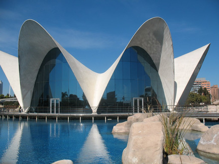
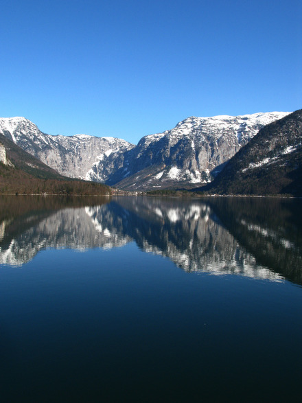
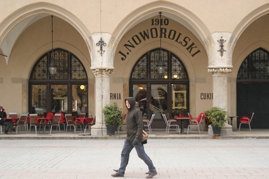
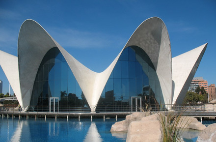
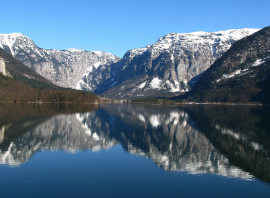
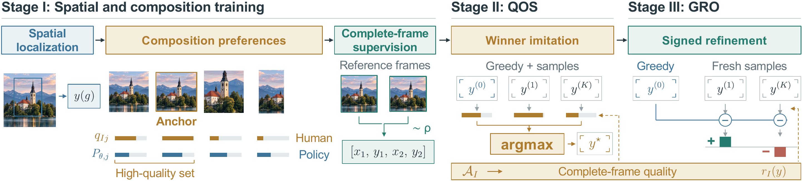
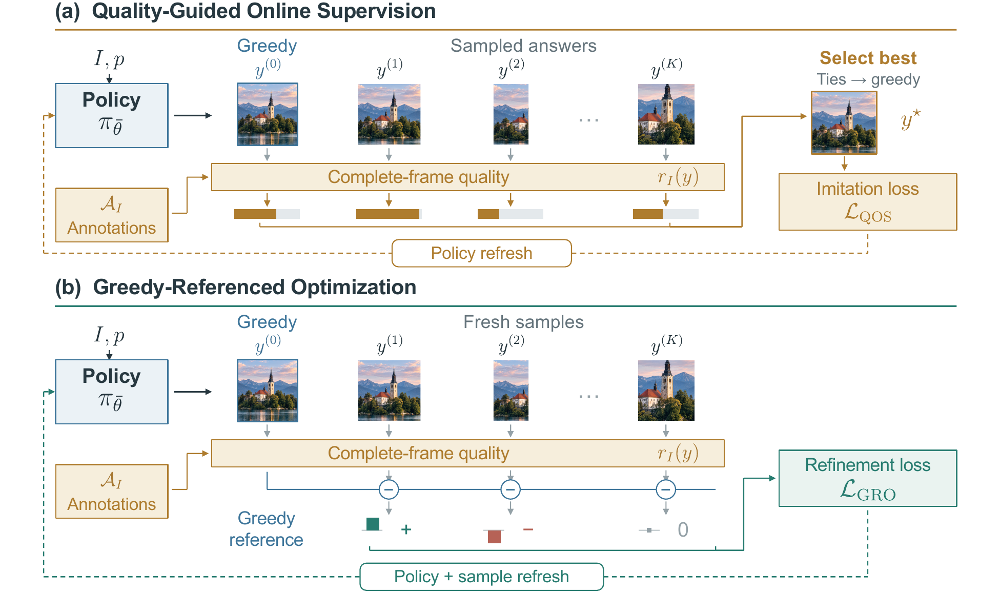

<div align="center">

# FrameLite：基于紧凑视觉语言模型的<br>面向决策的美学图像裁剪

**Jianze Li**<sup>1</sup>, **Kai Liu**<sup>1</sup>, **Ziqing Zhang**<sup>1</sup>, **Weihang Zhang**<sup>2</sup>,<br>
**Yong Guo**<sup>1</sup>, **Linghe Kong**<sup>1</sup>, **Yulun Zhang**<sup>1,†</sup>

<sup>1</sup> 上海交通大学<br>
<sup>2</sup> 华为媒体技术与体验设计研究所<br>
<sup>†</sup> 通讯作者

[](https://arxiv.org/abs/2610.17639)
[](https://github.com/JianzeLi-114/FrameLite/releases/download/v1.0/FrameLite_supplementary.pdf)
[](https://huggingface.co/mon3tr/FrameLite)
[](LICENSE)


[](https://github.com/JianzeLi-114/FrameLite/stargazers)
[](https://github.com/JianzeLi-114/FrameLite/forks)
[](https://huggingface.co/mon3tr/FrameLite)

[快速开始](#quick-start) · [English](README.md)

</div>

<table>
  <tr>
    <td align="center" width="33%"></td>
    <td align="center" width="33%"></td>
    <td align="center" width="33%"></td>
  </tr>
  <tr>
    <td align="center" width="33%"></td>
    <td align="center" width="33%"></td>
    <td align="center" width="33%"></td>
  </tr>
</table>
<p align="center"><em>论文中的示例。上排为输入图像，下排为 FrameLite 预测的裁剪结果。</em></p>

## 摘要

> 美学图像裁剪通过平衡主体、上下文和图像边界来改善构图。大型视觉语言模型为这一任务带来了语义知识，但其模型规模限制了轻量化摄影辅助应用。我们提出 **FrameLite**，一个基于 Qwen3.5-0.8B 的紧凑裁剪模型。我们的出发点是：小模型生成更好裁剪的能力，往往超出了其首次回答所呈现的水平。为将这种潜力转化为更强的直接预测能力，我们设计了三阶段训练。首先，空间与构图训练建立定位能力和取景偏好；随后，质量引导的在线监督（Quality-Guided Online Supervision，QOS）从当前策略生成的候选中，学习质量最高的完整答案；最后，贪心参照优化（Greedy-Referenced Optimization，GRO）利用相对于当前贪心答案的正、负质量差异，进一步优化策略。两个在线阶段均使用来自标注的反馈，而推理时仅输出一个坐标答案，无需搜索或外部评分器。实验表明，FrameLite 在公共基准上以显著更小的骨干模型，超越了参与比较的大型视觉语言裁剪模型。受控实验进一步证实，相比仅进行在线采样，选择高质量训练答案能够改善最终模型的性能。

## 方法

<p align="center">
  
</p>

FrameLite 通过三个阶段，逐步提升**同一个紧凑裁剪策略**：

1. **Stage I — 空间与构图训练。** 学习重要内容的位置、不同取景方案的优劣，以及完整参考裁剪框的预测。
2. **Stage II — 质量引导的在线监督（QOS）。** 生成贪心答案和采样答案，评估完整裁剪框的质量，并模仿最佳答案。
3. **Stage III — 贪心参照优化（GRO）。** 以当前贪心答案为参照，利用新采样答案的有符号质量差异优化策略。

推理时，模型通过一次贪心生成直接预测归一化裁剪坐标，无需候选搜索、外部评分器、检索数据库或外部 API。

<details>
<summary><strong>QOS 与 GRO 的具体流程</strong></summary>
<br>


QOS 将更好的生成候选转化为学习目标，GRO 随后利用正、负质量差异进一步优化策略。人工裁剪标注用于提供训练反馈，推理时不需要这些标注。

</details>

<a id="pretrained-model"></a>

## 预训练模型

| 模型 | 骨干模型 | 检查点 | 下载 |
|:---|:---|:---|:---|
| FrameLite | Qwen3.5-0.8B | 完成 Stage I → QOS → GRO 训练后的最终模型 | [Hugging Face](https://huggingface.co/mon3tr/FrameLite) |

FrameLite 任务权重约为 **224 MB**，包含训练后的语言 LoRA 和视觉融合模块。请从 [Hugging Face](https://huggingface.co/mon3tr/FrameLite) 下载任务权重，从 [Qwen/Qwen3.5-0.8B](https://huggingface.co/Qwen/Qwen3.5-0.8B) 下载基础模型。本地目录结构如下：

```text
weights/framelite/
├── base/                    # Downloaded separately from Qwen/Qwen3.5-0.8B
├── framelite.safetensors    # FrameLite language LoRA and trained vision merger
└── inference_config.json
```

下载这两部分后，通过 `FrameLite` API 加载模型。

<a id="quick-start"></a>

## 快速开始

### 安装

请使用 **Python 3.10** 和支持 BF16 的 CUDA GPU：

```bash
git clone https://github.com/JianzeLi-114/FrameLite.git
cd FrameLite

python3.10 -m venv .venv
source .venv/bin/activate
python -m pip install --upgrade pip
python -m pip install torch==2.6.0 torchvision==0.21.0 \
  --index-url https://download.pytorch.org/whl/cu124
python -m pip install -r requirements.txt
```

### 下载模型

从仓库根目录下载 FrameLite 任务权重和 Qwen 基础模型：

```bash
python - <<'PY'
from huggingface_hub import snapshot_download

snapshot_download(
    repo_id="mon3tr/FrameLite",
    local_dir="weights/framelite",
    allow_patterns=[
        "framelite.safetensors", "inference_config.json", "LICENSE", "NOTICE",
    ],
)

snapshot_download(
    repo_id="Qwen/Qwen3.5-0.8B",
    local_dir="weights/framelite/base",
)
PY
```

### 裁剪图像

使用仓库自带的一张示例图像：

```bash
python infer.py \
  --image assets/examples/curved_architecture/input.jpg \
  --output-dir outputs \
  --device cuda:0
```

如需处理整个目录，将目录路径传给 `--image`：

```bash
python infer.py --image path/to/images --output-dir outputs --device cuda:0
```

预测坐标保存至 `outputs/predictions.jsonl`，有效裁剪保存至 `outputs/crops/`。添加 `--recursive` 可包含子目录，添加 `--no-save-crops` 则仅保存坐标。运行 `python infer.py --help` 可查看全部选项。

### Python API

```python
from framelite import FrameLite, crop_image

model = FrameLite.from_pretrained("weights/framelite", device="cuda:0")
image_path = "assets/examples/curved_architecture/input.jpg"
result = model.predict(image_path)

if result["valid"]:
    print(result["bbox_normalized"])  # [x1, y1, x2, y2] in [0, 1]
    print(result["bbox_pixels"])      # Coordinates on the original image
    crop_image(image_path, result["bbox_normalized"]).save("crop.png")
else:
    print(result["error"])
```

输出包含原图上的归一化裁剪坐标 `[x1, y1, x2, y2]`，原点位于左上角。

输出字段、坐标约定和运行环境说明见[推理细节](docs/inference.md)。

## 实验结果

下表选取了论文中的部分对比结果，每张图像均预测一个裁剪框。FrameLite 在**三个基准上使用同一个最终模型**。

| Method | GAICv2 Acc .85 ↑ | GAICv2 Acc .90 ↑ | FLMS IoU ↑ | FLMS BDE ↓ | FCDB IoU ↑ | FCDB BDE ↓ |
|:---|---:|---:|---:|---:|---:|---:|
| GAICD | 0.8300 | 0.7640 | 0.8025 | 0.0470 | 0.6759 | 0.0819 |
| CACNet | 0.5100 | 0.2360 | 0.8401 | 0.0368 | 0.6967 | 0.0751 |
| Cropper | 0.6900 | 0.6460 | 0.7845 | 0.0829 | 0.6519 | 0.1089 |
| InstructCrop | 0.4740 | 0.1680 | 0.8145 | 0.0422 | 0.6848 | 0.0774 |
| Venus | 0.8380 | 0.7200 | 0.8638 | 0.0304 | 0.6836 | 0.0794 |
| **FrameLite** | **0.9140** | **0.8340** | **0.8679** | **0.0297** | **0.7124** | **0.0704** |

Acc 表示在指定 IoU 阈值下计算的 GAICv2 $\mathrm{Acc}_{1/5}$。Acc 和 IoU 越高越好，BDE 越低越好。完整对比与评测协议见[论文](https://arxiv.org/abs/2610.17639)，额外消融、用户研究和定性对比见[补充材料](https://github.com/JianzeLi-114/FrameLite/releases/download/v1.0/FrameLite_supplementary.pdf)。

## 引用

如果 FrameLite 对你的研究有所帮助，欢迎引用我们的工作：

```bibtex
@misc{li2026framelite,
  title={FrameLite: Decision-Oriented Aesthetic Cropping with a Compact Vision--Language Model},
  author={Li, Jianze and Liu, Kai and Zhang, Ziqing and Zhang, Weihang and Guo, Yong and Kong, Linghe and Zhang, Yulun},
  year={2026},
  eprint={2610.17639},
  archivePrefix={arXiv},
  primaryClass={cs.CV},
  url={https://arxiv.org/abs/2610.17639}
}
```

## 许可与致谢

FrameLite 代码和任务权重采用 [Apache License 2.0](LICENSE)。单独下载的 Qwen3.5-0.8B 基础模型保留其上游 [Apache-2.0 许可证](https://huggingface.co/Qwen/Qwen3.5-0.8B/blob/main/LICENSE)，详见 [NOTICE](NOTICE)。

感谢 [Qwen](https://github.com/QwenLM)、[Transformers](https://github.com/huggingface/transformers) 和 [PEFT](https://github.com/huggingface/peft) 的开发者。

如有问题，欢迎提交 issue。通讯联系：[Yulun Zhang](mailto:yulun100@gmail.com)。
